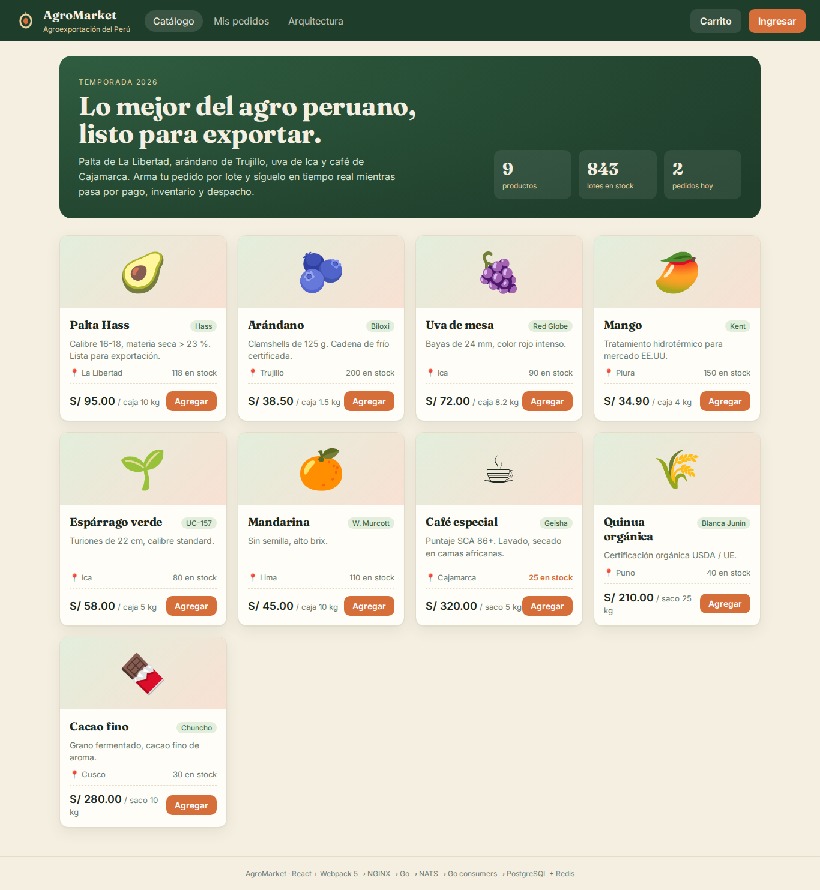
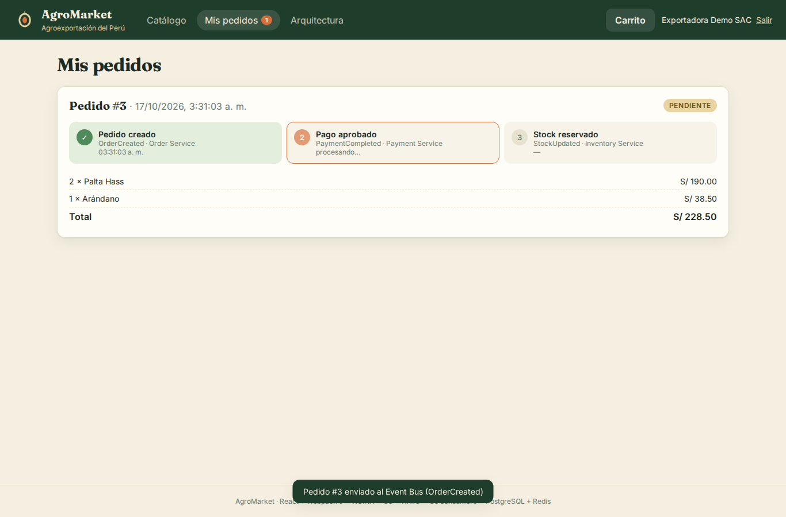
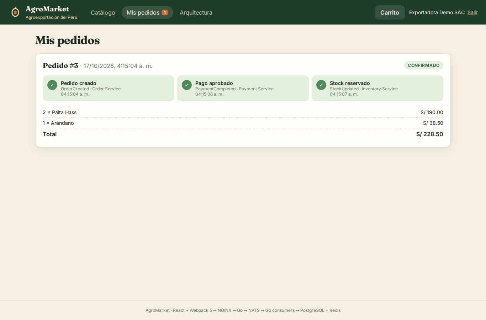
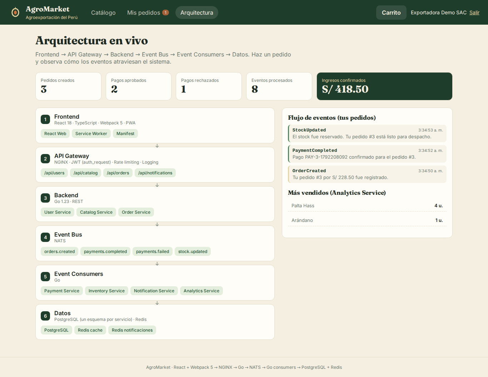
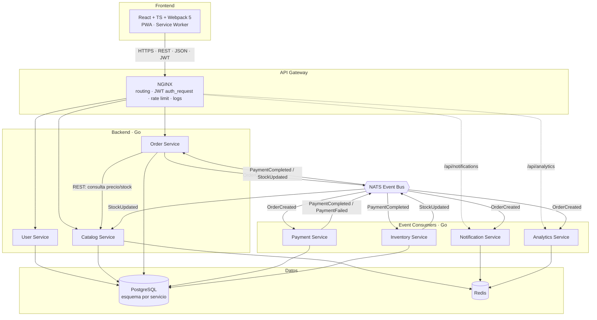
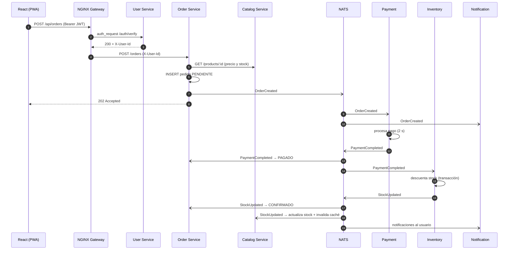

# 🥑 AgroMarket

[](https://codespaces.new/Yarlett22/agromarket?quickstart=1)

> **Probar sin instalar nada:** clic en el botón de arriba → *Create codespace*. En 3–5 min se levantan los 12 contenedores y se abre la app automáticamente (puerto 8080).

**Plataforma de pedidos de productos agroexportables del Perú** construida con una arquitectura Full Stack **distribuida y orientada a eventos**:

```
Frontend → API Gateway → Backend → Event Bus → Event Consumers → Datos
```

| Capa | Tecnología | Implementación en el proyecto |
|---|---|---|
| **Frontend** | React 18 · TypeScript · **Webpack 5** · PWA | `frontend/` — catálogo, carrito, seguimiento de pedidos en vivo y vista de arquitectura. Service Worker (Workbox) + Web App Manifest = instalable y con caché offline del catálogo. |
| **API Gateway** | **NGINX** | `gateway/nginx.conf` — routing a cada microservicio, **autenticación JWT centralizada** (`auth_request`), **rate limiting** (429), **logging JSON** y cabeceras de seguridad. |
| **Backend** | **Go** | `services/cmd/user` (registro/login/JWT), `catalog` (productos + caché Redis), `order` (crea pedidos y publica `OrderCreated`). |
| **Event Bus** | **NATS** | Subjects `orders.created`, `payments.completed`, `payments.failed`, `stock.updated`, con *queue groups*. |
| **Event Consumers** | **Go** | `payment` (pasarela simulada), `inventory` (descuenta stock), `notification` (notificaciones por usuario), `analytics` (métricas de negocio). |
| **Datos** | **PostgreSQL** + **Redis** | Un **esquema por servicio** (`users`, `catalog`, `orders`, `payments`, `inventory`) → *data ownership*. Redis: caché del catálogo, notificaciones y métricas. |
| **Plataforma** | Docker Compose · GitHub Actions | 12 contenedores con un solo comando; CI que compila backend y frontend. |

## 📸 Capturas

> Generadas automáticamente por el pipeline de CI (Playwright), que levanta toda la arquitectura en Docker.

| Catálogo | Pedido procesándose (asíncrono) |
|---|---|
|  |  |
| **Pedido confirmado** | **Arquitectura en vivo** |
|  |  |

---

## 🏗️ Arquitectura



### Flujo completo de una compra (síncrono + asíncrono)



**Estados del pedido:** `PENDIENTE → PAGADO → CONFIRMADO`, o `PENDIENTE → RECHAZADO` si el pago falla (regla simulada: monto mayor a **S/ 5,000**).

---


## 📁 Estructura

```
agromarket/
├── docker-compose.yml        # orquestación de los 12 contenedores
├── gateway/nginx.conf        # API Gateway
├── db/init.sql               # esquemas por servicio + datos semilla
├── frontend/                 # React + TypeScript + Webpack 5 + PWA
│   ├── webpack.config.js     # loaders, code splitting, Workbox (Service Worker)
│   ├── public/               # index.html, manifest, íconos
│   └── src/                  # App, componentes, cliente API
└── services/                 # Go (un módulo, un binario por servicio)
    ├── Dockerfile            # multi-stage, --build-arg SERVICE=...
    ├── internal/common/      # eventos, conexión a Postgres/Redis/NATS, helpers
    └── cmd/
        ├── user/  catalog/  order/                     # Backend
        └── payment/  inventory/  notification/  analytics/   # Event consumers
```

## 🔌 Endpoints (vía Gateway)

| Método | Ruta | Auth | Servicio |
|---|---|---|---|
| POST | `/api/users/register` | — | User |
| POST | `/api/users/login` | — | User |
| GET | `/api/catalog/products` | — | Catalog (caché Redis) |
| POST | `/api/orders` | JWT | Order → publica `OrderCreated` |
| GET | `/api/orders` | JWT | Order |
| GET | `/api/notifications` | JWT | Notification |
| GET | `/api/analytics` | — | Analytics |

## 🧭 Decisiones de diseño

- **NATS** como Event Bus: liviano, de baja latencia y nativo de Go. Los *queue groups* permiten escalar consumidores (`docker compose up --scale payment-service=3`).
- **Autenticación en el Gateway:** NGINX valida el JWT con `auth_request` antes de enrutar. Los microservicios reciben la identidad en `X-User-Id` y no exponen puertos al exterior.
- **Data ownership:** cada servicio usa su propio esquema. El Catalog Service no lee la tabla del Inventory, sino que mantiene su copia del stock **consumiendo `StockUpdated`** (consistencia eventual).
- **Respuesta `202 Accepted`:** el pedido se acepta al instante y el resto se procesa de forma asíncrona. El frontend consulta el estado periódicamente.

