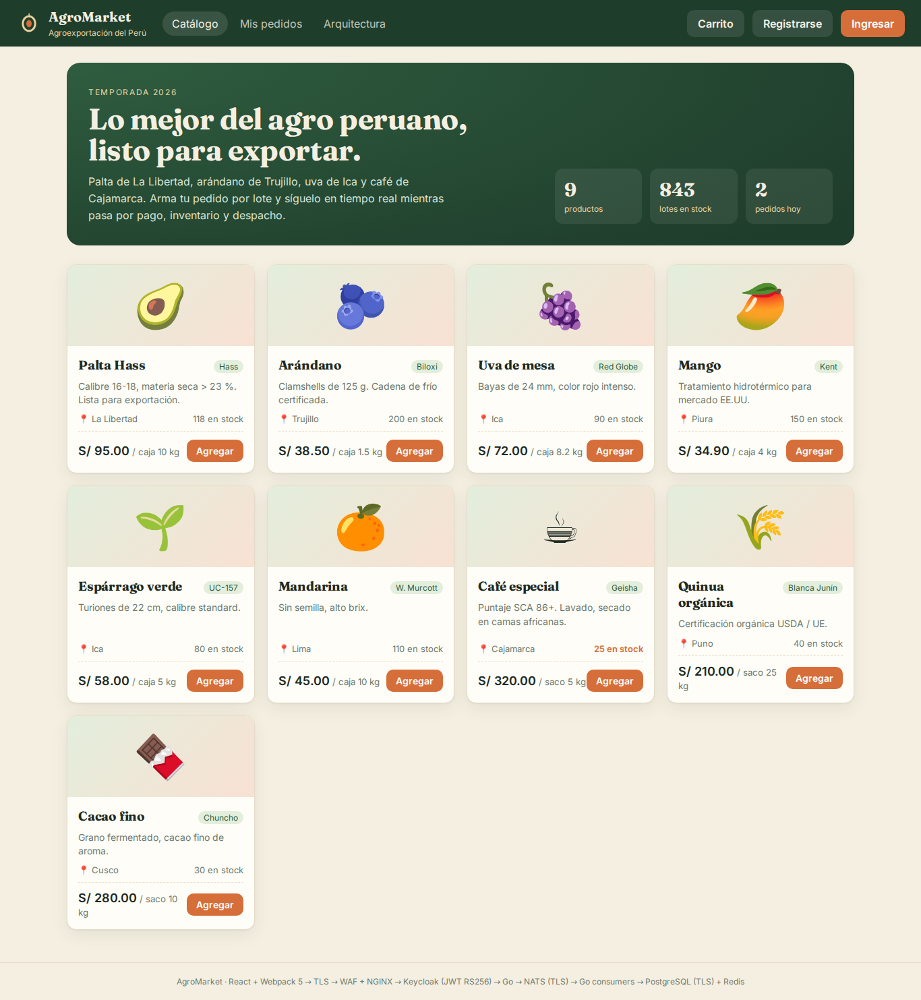
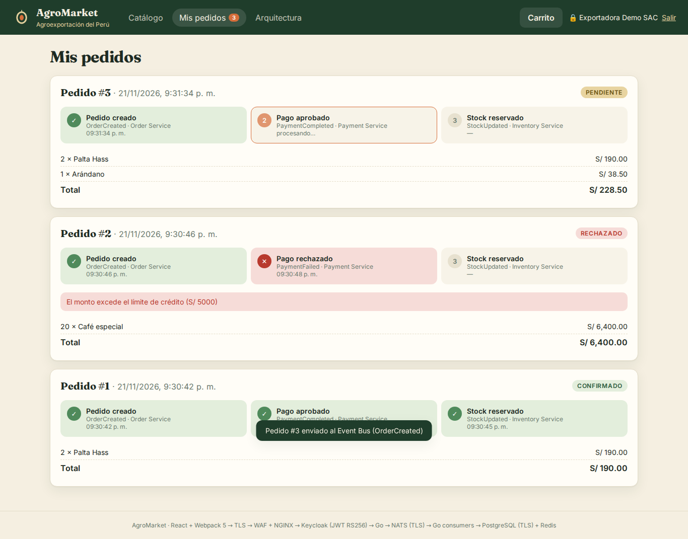
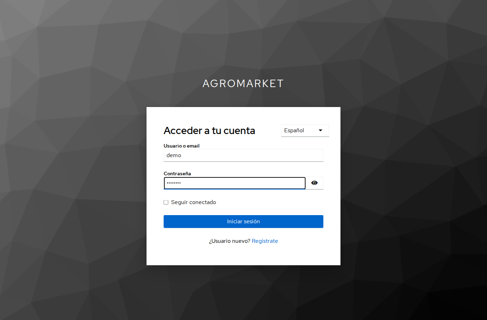
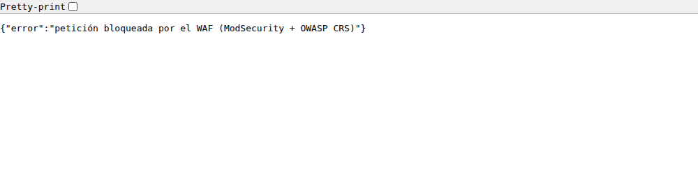
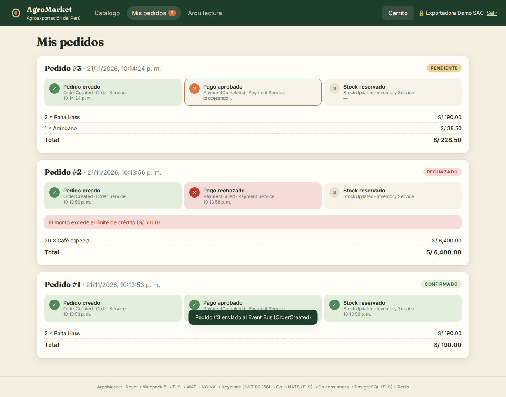
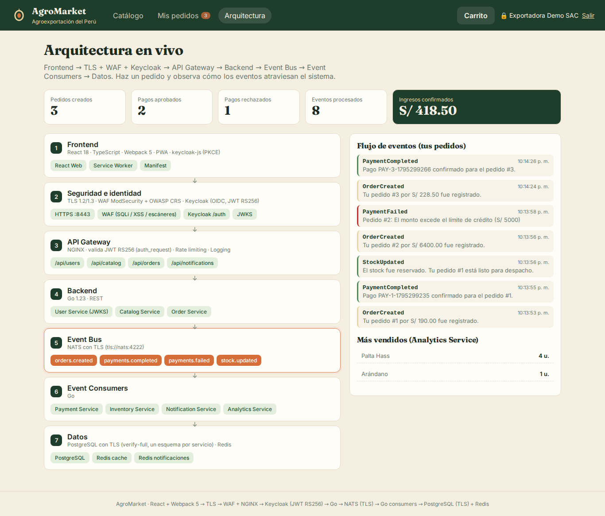
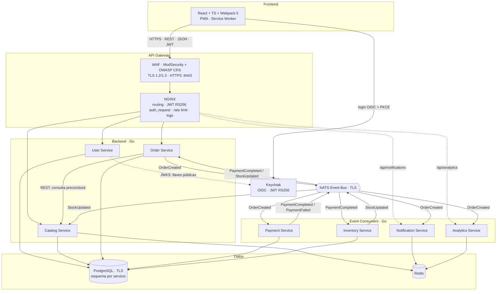
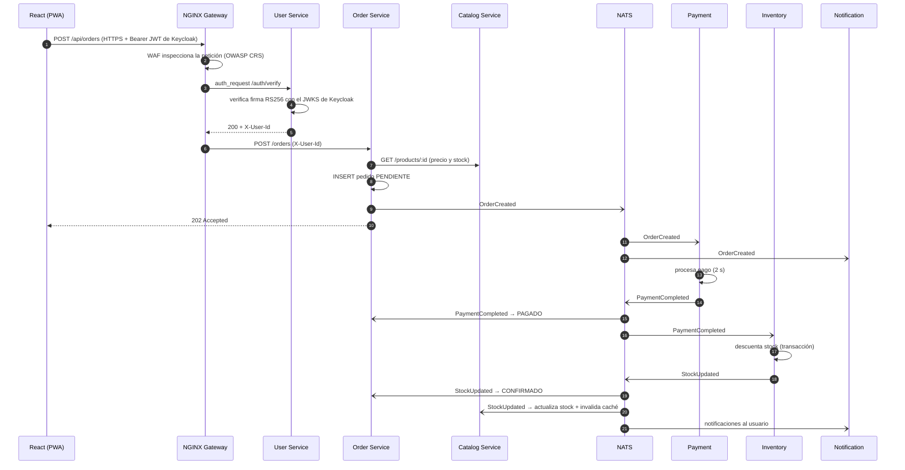
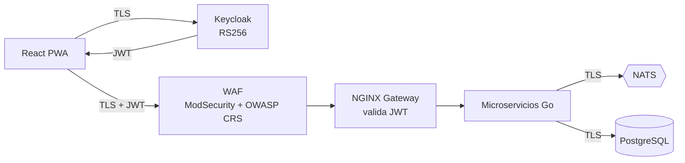

# 🥑 AgroMarket

[](https://codespaces.new/Yarlett22/agromarket?quickstart=1)

**Plataforma de pedidos de productos agroexportables del Perú** con arquitectura Full Stack distribuida, orientada a eventos y **segura**:

```
React ─TLS─► WAF + API Gateway ─► Backend ─TLS─► Event Bus ─► Event Consumers ─TLS─► Datos
           └─► Keycloak (OIDC · JWT RS256)
```

| Capa | Tecnología | Implementación en el proyecto |
|---|---|---|
| **Frontend** | React 18 · TypeScript · **Webpack 5** · PWA | `frontend/` — catálogo, carrito, seguimiento de pedidos en vivo y vista de arquitectura. Service Worker (Workbox) + Web App Manifest = instalable y con caché offline del catálogo. |
| **Seguridad** | **TLS** · **WAF** ModSecurity + OWASP CRS · **Keycloak** | HTTPS obligatorio, firewall de aplicaciones web que bloquea SQLi/XSS/escáneres, e identidad OIDC con tokens **JWT RS256**. Ver [🔐 Seguridad](#-seguridad). |
| **API Gateway** | **NGINX** | `gateway/nginx.conf.template` — routing, **validación centralizada del JWT de Keycloak** (`auth_request`), **rate limiting** (429), **logging JSON**, HSTS y cabeceras de seguridad. |
| **Backend** | **Go** | `services/cmd/user` (valida tokens de Keycloak con JWKS + perfil local), `catalog` (productos + caché Redis), `order` (crea pedidos y publica `OrderCreated`). |
| **Event Bus** | **NATS** (TLS) | Subjects `orders.created`, `payments.completed`, `payments.failed`, `stock.updated`, con *queue groups*. |
| **Event Consumers** | **Go** | `payment` (pasarela simulada), `inventory` (descuenta stock), `notification` (notificaciones por usuario), `analytics` (métricas de negocio). |
| **Datos** | **PostgreSQL** (TLS) + **Redis** | Un **esquema por servicio** (`users`, `catalog`, `orders`, `payments`, `inventory`) → *data ownership*. Redis: caché del catálogo, notificaciones y métricas. |
| **Plataforma** | Docker Compose · GitHub Actions | 13 contenedores + generador de certificados con un solo comando; CI que levanta todo y prueba TLS, WAF, Keycloak y el flujo de eventos. |

## 📸 Capturas

> Generadas automáticamente por el pipeline de CI (Playwright), que levanta toda la arquitectura en Docker.

| Catálogo | Pedido procesándose (asíncrono) |
|---|---|
|  |  |
| **Login con Keycloak** | **Ataque SQLi bloqueado por el WAF** |
|  |  |
| **Pedido confirmado** | **Arquitectura en vivo** |
|  |  |

---

## 🏗️ Arquitectura



### Flujo completo de una compra (síncrono + asíncrono)



**Estados del pedido:** `PENDIENTE → PAGADO → CONFIRMADO`, o `PENDIENTE → RECHAZADO` si el pago falla (regla simulada: monto mayor a **S/ 5,000**).

---

## 🔐 Seguridad

Implementa la cadena de seguridad de la arquitectura de referencia:



| Mecanismo | Implementación | Cómo comprobarlo |
|---|---|---|
| **TLS cliente ↔ gateway** | HTTPS en `:8443` (TLS 1.2/1.3), `:8080` redirige a HTTPS, cabecera HSTS. Certificados emitidos por una **CA interna** (`scripts/gen-certs.sh`). | `curl -kI https://localhost:8443` |
| **WAF** | Imagen `owasp/modsecurity-crs:nginx-alpine`: **ModSecurity v3 + OWASP Core Rule Set** (paranoia 1, modo bloqueo). Bloquea inyección SQL, XSS, path traversal, RCE y escáneres. | `curl -k "https://localhost:8443/api/catalog/products?q=1'%20OR%20'1'='1"` → **403** |
| **Keycloak** | Realm `agromarket` (`keycloak/realm-agromarket.json`): cliente público `agromarket-web` con **Authorization Code + PKCE**, registro de usuarios, roles `cliente`/`admin`, protección contra fuerza bruta. | https://localhost:8443/auth/admin (admin / admin) |
| **JWT RS256** | Keycloak firma con su llave privada; el **User Service** descarga las llaves públicas (**JWKS**) y verifica firma, expiración, emisor y cliente. El gateway lo consulta con `auth_request` antes de enrutar. | Sin token o con token falso → **401** |
| **TLS Event Bus** | NATS con `--tls`; los servicios se conectan a `tls://nats:4222` verificando la CA. | http://localhost:8222/varz → `"tls_required": true` |
| **TLS base de datos** | PostgreSQL con `ssl=on`, `pg_hba` solo `hostssl`; los servicios usan `sslmode=verify-full`. | `docker compose exec postgres psql -U agro -d agromarket -c "select * from pg_stat_ssl"` |

**Usuarios de prueba:** `demo / demo1234` (cliente) y `profesor / profesor123` (cliente + admin). También se puede crear una cuenta con **Registrarse**.

## 🚀 Ejecutar

```bash
docker compose down -v        # solo si ya lo habías ejecutado antes (recrea la base con TLS)
docker compose up -d --build
```

Abrir **https://localhost:8443** y aceptar el aviso del navegador (el certificado lo emite la CA interna del proyecto). Keycloak tarda ~30 s en estar listo la primera vez. Verificación completa: `./scripts/smoke-test.sh`.

---


## 📁 Estructura

```
agromarket/
├── docker-compose.yml        # orquestación de los contenedores
├── gateway/nginx.conf.template  # API Gateway + WAF + TLS
├── keycloak/realm-agromarket.json  # realm, cliente OIDC y usuarios demo
├── scripts/gen-certs.sh      # CA interna y certificados TLS
├── db/init.sql, 00-ssl.sh    # esquemas por servicio + solo conexiones TLS
├── frontend/                 # React + TypeScript + Webpack 5 + PWA
│   ├── webpack.config.js     # loaders, code splitting, Workbox (Service Worker)
│   ├── public/               # index.html, manifest, íconos
│   └── src/                  # App, componentes, cliente API
└── services/                 # Go (un módulo, un binario por servicio)
    ├── Dockerfile            # multi-stage, --build-arg SERVICE=...
    ├── internal/common/      # eventos, conexión a Postgres/Redis/NATS, helpers
    └── cmd/
        ├── user/  catalog/  order/                     # Backend
        └── payment/  inventory/  notification/  analytics/   # Event consumers
```

## 🔌 Endpoints (vía Gateway)

| Método | Ruta | Auth | Servicio |
|---|---|---|---|
| — | `/auth/...` | — | Keycloak (login, registro, tokens, consola admin) |
| GET | `/api/users/me` | JWT | User (perfil del token) |
| GET | `/api/catalog/products` | — | Catalog (caché Redis) |
| POST | `/api/orders` | JWT | Order → publica `OrderCreated` |
| GET | `/api/orders` | JWT | Order |
| GET | `/api/notifications` | JWT | Notification |
| GET | `/api/analytics` | — | Analytics |

## 🧭 Decisiones de diseño

- **NATS** como Event Bus: liviano, de baja latencia y nativo de Go. Los *queue groups* permiten escalar consumidores (`docker compose up --scale payment-service=3`).
- **Identidad delegada a Keycloak:** ningún microservicio guarda contraseñas. NGINX valida el JWT RS256 con `auth_request` antes de enrutar. Los microservicios reciben la identidad en `X-User-Id` y no exponen puertos al exterior.
- **Data ownership:** cada servicio usa su propio esquema. El Catalog Service no lee la tabla del Inventory, sino que mantiene su copia del stock **consumiendo `StockUpdated`** (consistencia eventual).
- **Respuesta `202 Accepted`:** el pedido se acepta al instante y el resto se procesa de forma asíncrona. El frontend consulta el estado periódicamente.

